## Sobre mí

- Estudio en **U-tad**, en Madrid.
- He creado **[DesguaPro](https://desguapro.com)**, un software para desguaces de coches y motos: pone precios competitivos solo, ficha a los operarios y cruza referencias OEM desde un mismo sitio.
- Me gusta hacer herramientas que me ahorren trabajo, webs con buena pinta y juegos.
- Últimamente trabajo mucho con IA: agentes, extracción de datos y Claude Code.

## Proyectos destacados

<table>
<tr>
<td width="50%" valign="top">

### [desguaproterm](https://github.com/juliosoria9/desguaproterm)

Terminal para Windows para trabajar con varios Claude Code a la vez: las sesiones vuelven al reiniciar, panel de agentes, gasto por tarea y 8 temas. Todo en un `.exe` de 5,5 MB.

</td>
<td width="50%" valign="top">

### [PrecIA](https://github.com/juliosoria9/precia)

Extractor comparativo de datos de producto con IA adaptativa (proyecto universitario). Saca de cada tienda los campos que pidas (precio, referencia OEM, marca, estado…) y los compara, con histórico y alertas.

La IA genera y repara la configuración de scraping de cada tienda nueva; después esa configuración se reutiliza sin IA.

### [bildyapp-api](https://github.com/juliosoria9/bildyapp-api)

API REST de albaranes: usuarios, empresas, clientes, proyectos y albaranes digitales con firma, PDF y subida a la nube.

</td>
</tr>
<tr>
<td valign="top">

### [Juego de cartas en C++](https://github.com/juliosoria9/Juego_algoritmos)

Juego por turnos para dos jugadores con cartas de puntos y habilidades especiales: gana quien se lleva 2 de 3 rondas.

</td>
<td valign="top">

### [Sistema de ficheros en C](https://github.com/juliosoria9/simulacion-de-sistema-deficheros-c)

Simulación de un sistema de ficheros, hecha en pareja.

</td>
</tr>
</table>

Y más: [Karma](https://github.com/juliosoria9/Karma) (app móvil con React Native), un [buscador de series](https://github.com/juliosoria9/proyectowebfinal) con React, [Spagetify](https://github.com/juliosoria9/proyectoweb_2) (clon de Spotify) y un [battle royale en Java](https://github.com/juliosoria9/Battle_Royale_Java).

## Con qué trabajo

